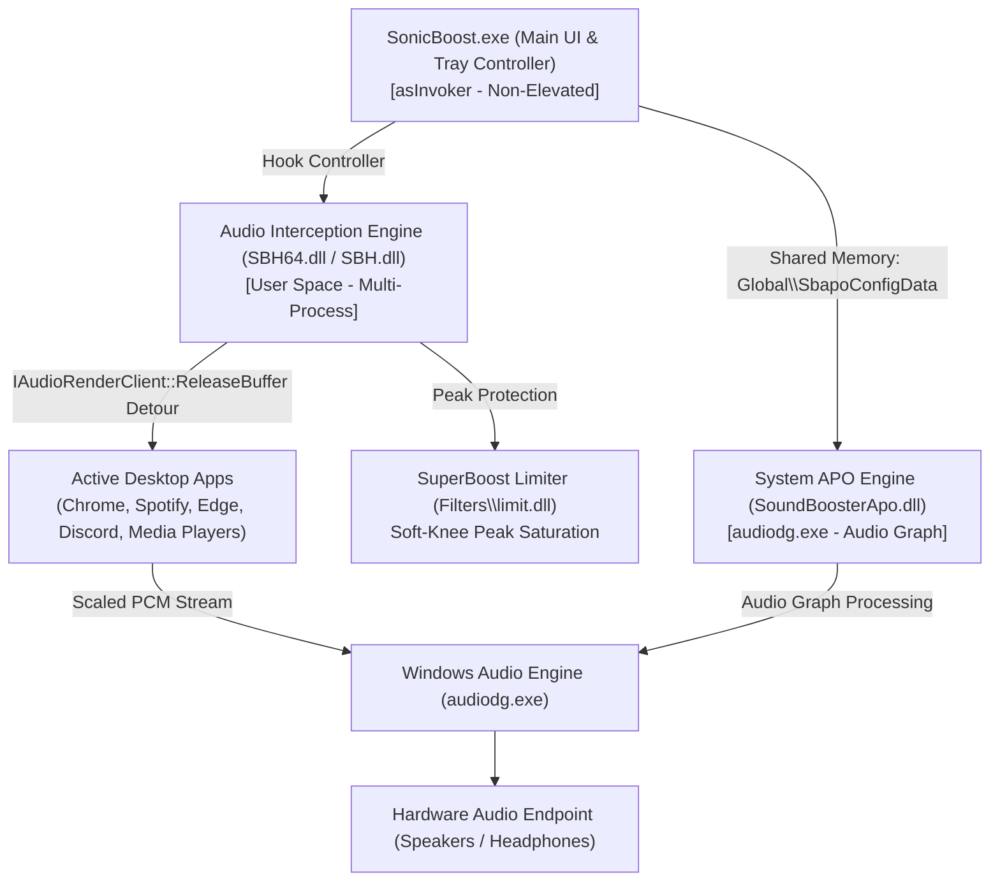

# SonicBoost — Technical Architecture & Specification
## Author: Reddy A. Rohan on earth

---

### 1. Executive Summary

**SonicBoost** is an advanced Windows audio enhancement utility engineered to provide system-wide volume amplification beyond standard $100\%$ hardware output limits, achieving up to **$500\%$ ($+20\text{ dB}$)** boost.

The application utilizes a **Dual-Engine Architecture** balancing user-space dynamic stream scaling with Windows Core Audio Graph processing.

---

### 2. Architectural Overview

---

### 3. Subsystem Specifications

#### 3.1. In-Process Audio Interception Engine
* **Interception Target**: `IAudioRenderClient::ReleaseBuffer`, `IDirectSoundBuffer::Unlock`, and `waveOutWrite`.
* **Dynamic Hooking**: Utilizes `SetWindowsHookExW` across active desktop threads to load the engine into audio-producing processes.
* **Sample Multiplication**: Scales floating-point and integer PCM audio frames in real time before submission to the Windows audio mixing session.
* **Volume Control Range**: $100\%$ ($1.0\times$, unity gain) to $500\%$ ($5.0\times$, $+20\text{ dB}$).
* **Limiter Integration**: Routes samples exceeding $0\text{ dBFS}$ through `Filters\limit.dll` to prevent digital clipping distortion.

#### 3.2. Audio Processing Object (APO) Engine
* **COM Class Factory**: Registered under `CLSID_SoundBoosterApo` implementing `IAudioProcessingObjectRT`.
* **Location**: Operates within `audiodg.exe` prior to DAC transmission.
* **Inter-Process Synchronization**: Communicates via `Global\SbapoConfigData` and `Global\SbapoDataUpdate` events.

#### 3.3. User Interface & Presentation Layer
* **Visual Style**: Liquid fluid glassmorphism with minimalist dark styling.
* **System Tray**: Displays the high-resolution `SonicBoost.ico` in the Windows Notification Area. Left-click toggles the slider; right-click displays the context menu.
* **Slider Popup**: Inverted vertical trackbar ($-500$ to $-100$) tracking $100\%$ to $500\%$ volume, complete with mouse-wheel control, bypass checkbox, and tracking tooltip.
* **Settings Dialog**: Options for Windows startup, preset volume, customizable hotkeys (`Ctrl + Alt + F10` / `Ctrl + Alt + F9`), and auto-hide behaviors.

---

### 4. Configuration & State Persistence

* **Primary Registry Hive**: `HKCU\Software\SonicBoost\Options`
  * `SoundLevel` (DWORD): Stored volume percentage ($100$ to $500$).
  * `BoostIsEnabled` (DWORD): $1$ if enabled, $0$ if bypassed.
  * `BoostMethod` (DWORD): $0$ (Interception), $1$ (Dual Engine), $2$ (APO).
  * `CompressorIsEnabled` (DWORD): $1$ for SuperBoost limiter, $0$ for standard.
  * `AutoHide` (DWORD): Auto-dismiss popup on focus loss.
  * `StartupTip` (DWORD): Display system tray balloon notification on launch.
  * `AppAutoStart` (DWORD): Automatic launch with Windows.
  * `AppHotKeys` (BINARY): Registered hotkey configurations.
