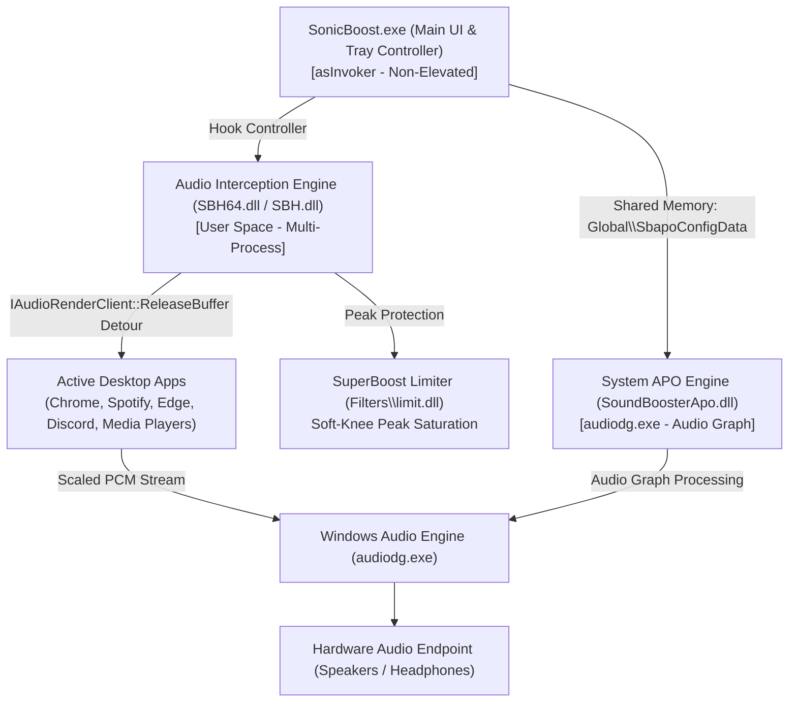

# SonicBoost 🔊

<p align="center">
  
</p>

<p align="center">
  <strong>Next-Generation System-Wide Windows Audio Amplifier</strong><br/>
  <em>Elevating PC Volume Beyond Hardware Limits up to 500% (+20 dB) with Studio-Grade Dynamic Limiting</em>
</p>

<p align="center">
  <a href="LICENSE"></a>
  
  
  
  
</p>

---

## 🌟 Overview

**SonicBoost** is a high-performance, system-wide audio amplifier engineered for Microsoft Windows. Designed and developed by **Reddy A. Rohan on earth**, SonicBoost breaks through standard $100\%$ hardware limitations to deliver up to **$500\%$ ($+20\text{ dB}$)** sound amplification across all applications, games, and web streams.

Unlike traditional software boosters that cause severe acoustic clipping and digital distortion, SonicBoost incorporates real-time **SuperBoost soft-knee saturation and peak limiting** alongside a **Dual-Engine Audio Core** to maintain crystal-clear audio fidelity at peak volumes.

---

## ✨ Key Features

* **⚡ Dual-Engine Audio Architecture**:
  * **In-Process Interception Engine (`SBH64.dll` / `SBH.dll`)**: Intercepts raw PCM render buffers (`IAudioRenderClient::ReleaseBuffer`, `IDirectSoundBuffer::Unlock`, and `waveOutWrite`) directly in user-space processes (Chrome, Spotify, Edge, Discord, VLC, games, etc.) prior to audio mixing. Works instantly on any sound device without requiring driver modifications.
  * **Core Audio APO Engine (`SoundBoosterApo.dll`)**: High-fidelity Windows Audio Processing Object registered into the Windows Audio Graph (`audiodg.exe`) right before DAC transmission.
* **🛡️ SuperBoost Soft-Knee Saturation**:
  * Dynamic non-linear limiting (`Filters\limit.dll`) prevents harsh digital clipping and harmonic distortion when pushing high-amplitude audio up to 500%.
* **💎 Liquid & Minimalist Interface**:
  * Liquid glassmorphic notification tray icon with live status reporting.
  * Precision vertical volume slider ($100\%$ to $500\%$) featuring mouse-wheel sensitivity and dynamic tracking tooltips.
  * Smooth auto-hide popup behavior for seamless background operation.
* **⌨️ Global Background Hotkeys**:
  * Adjust system volume on the fly from within full-screen games or video players using `Ctrl + Alt + F10` (Boost) and `Ctrl + Alt + F9` (Reduce).
* **🔄 Dynamic Endpoint Switching**:
  * Listens to `IMMNotificationClient` hardware events to adaptively handle headphone connections, Bluetooth headsets, and external sound cards.
* **🔓 Permanently Unlocked**:
  * 100% free and open-source. No trial timeouts, no paywalls, no background telemetry.

---

## 🏗️ System Architecture



---

## 📁 Repository Structure

```
SonicBoost/
├── apo/                           # Windows Audio Processing Object (APO) subsystem
│   ├── SoundBoosterApo.h          # CSoundBoosterAPO class declaration (CBaseAudioProcessingObject)
│   ├── SoundBoosterApo.cpp        # Real-time DSP audio processor & config synchronization
│   ├── dllmain.cpp                # COM ClassFactory, DllRegisterServer, DllUnregisterServer
│   ├── SoundBoosterApo.def        # Linker export definitions
│   └── build_apo.bat              # Standalone 64-bit APO compilation script
├── Filters/                       # DSP filter libraries
│   ├── gain.dll                   # High-precision linear gain DSP
│   └── limit.dll                  # SuperBoost soft-saturation peak limiter
├── SBH64.dll                      # 64-bit In-Process Audio Interception Engine
├── SBH.dll                        # 32-bit In-Process Audio Interception Engine
├── ApoController.h / .cpp         # IPC controller managing shared memory (Global\SbapoConfigData)
├── ApoManager.h / .cpp            # Windows Core Audio endpoint enumerator & registry manager
├── AudioEngine.h / .cpp           # Dual-engine orchestrator & IMMNotificationClient listener
├── DspEngine.h / .cpp             # Mathematical DSP operations: gain scaling & limiting
├── HookController.h / .cpp        # High-performance dispatch controller for injection engine
├── SettingsManager.h / .cpp       # Registry options persistence (HKCU\Software\SonicBoost\Options)
├── SettingsDialog.h / .cpp        # Settings dialog (autostart, hotkeys, startup volume)
├── SliderPopup.h / .cpp           # Fluid volume slider popup with live tooltip & auto-dismiss
├── TrayManager.h / .cpp           # System notification tray icon & context menu
├── resource.h / resource.rc       # Embedded resource definitions & icon mapping
├── SonicBoost.ico                 # Multi-resolution liquid glassmorphic application icon
├── app.manifest                   # ComCtl32 v6 visual styling & asInvoker security manifest
├── main.cpp                       # WinMain entry point, single-instance mutex, and message pump
├── build.bat                      # Master MSVC build script (compiles EXE and APO DLL)
├── clean.bat                      # Wipes intermediate compiler and linker objects
├── register_apo.bat               # Installs and enables the APO across all active endpoints
├── unregister_apo.bat             # Restores default audio endpoints and unregisters APO
├── CONTRIBUTING.md                # Community contribution guidelines
├── LICENSE                        # MIT Open-Source License
└── README.md                      # Project documentation and specifications
```

---

## 🚀 Quick Start

### Running SonicBoost
1. Launch `SonicBoost.exe`.
2. Click the **SonicBoost** liquid glass icon in the Windows taskbar system tray.
3. Drag the slider to your desired amplification level (up to **500%**).
4. Right-click the tray icon to access **Settings**, toggle **SuperBoost**, or select your preferred **Boost Mode**.

### Hotkeys

| Shortcut | Action | Description |
| :--- | :--- | :--- |
| `Ctrl + Alt + F10` | Volume Up | Increases audio amplification by step |
| `Ctrl + Alt + F9` | Volume Down | Decreases audio amplification by step |
| Left-Click Tray | Toggle Slider | Shows / hides fluid vertical volume slider |
| Right-Click Tray | Context Menu | Opens Settings, Boost Modes, and Exit |

---

## 🛠️ Building from Source

### Prerequisites
* Windows 10 or 11 (64-bit)
* **Microsoft Visual Studio 2022** (or Visual Studio Build Tools) with:
  * *Desktop development with C++*
  * *Windows 10/11 SDK*

### Build Steps

1. Open **Developer Command Prompt for VS 2022** (or standard Command Prompt / PowerShell).
2. Navigate to the project directory:
   ```cmd
   cd D:\Tools\projects\SonicBoost
   ```
3. Run the automated build script:
   ```cmd
   build.bat
   ```
4. To clean intermediate files at any time:
   ```cmd
   clean.bat
   ```

---

## ⚙️ Configuration & Registry

Settings are persisted in the Windows Registry under `HKCU\Software\SonicBoost\Options`:

| Key | Type | Description |
| :--- | :--- | :--- |
| `SoundLevel` | `DWORD` | Amplification level percentage ($100$ to $500$) |
| `BoostIsEnabled` | `DWORD` | Master toggle ($1$ = active, $0$ = bypassed) |
| `BoostMethod` | `DWORD` | $0$ = In-Process Interception, $1$ = Dual Engine, $2$ = APO |
| `CompressorIsEnabled` | `DWORD` | $1$ = SuperBoost Limiter active, $0$ = Linear Gain |
| `AutoHide` | `DWORD` | $1$ = Automatically dismiss slider on focus loss |
| `StartupTip` | `DWORD` | $1$ = Show tray balloon notification upon launch |
| `AppAutoStart` | `DWORD` | $1$ = Automatically launch at Windows login |
| `AppHotKeys` | `BINARY` | Custom keyboard hotkey binding assignments |

---

## 📄 License

This project is licensed under the **MIT License** — see the [LICENSE](LICENSE) file for details.

---

## 👤 Author & Credits

* **Lead Architect & Developer**: **Reddy A. Rohan on earth**
* **Project**: **SonicBoost**
