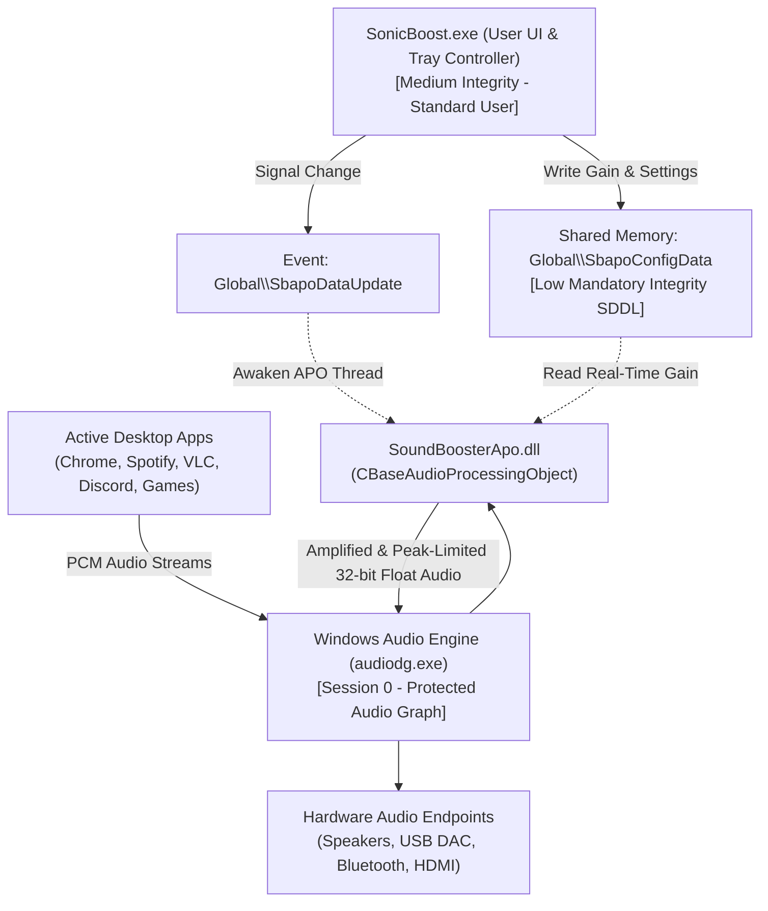

# SonicBoost 🔊

<p align="center">
  
</p>

<h3 align="center">SonicBoost — Next-Generation System-Wide Windows Audio Amplifier</h3>

<p align="center">
  <em>Elevating PC volume beyond standard hardware limitations up to 500% (+14 dB) with studio-grade dynamic limiting and native Windows Audio Processing Objects (APO).</em>
</p>

<p align="center">
  <a href="LICENSE"></a>
  
  
  
  
  <a href="https://buymeacoffee.com/rohanslappi"></a>
</p>

---

## 📖 Table of Contents

- [🌟 Overview](#-overview)
- [✨ Key Features](#-key-features)
- [🏗️ System Architecture](#️-system-architecture)
- [📁 Repository Structure](#-repository-structure)
- [🚀 Quick Start & Installation](#-quick-start--installation)
- [⌨️ Keyboard Shortcuts](#️-keyboard-shortcuts)
- [🛠️ Building from Source](#️-building-from-source)
- [🌐 Universal Hardware Compatibility](#-universal-hardware-compatibility)
- [⚙️ Configuration & Registry](#️-configuration--registry)
- [👤 Author & Credits](#-author--credits)
- [☕ Support the Project](#-support-the-project)
- [📄 License](#-license)

---

## 🌟 Overview

**SonicBoost** is a high-performance, system-wide audio amplification utility engineered specifically for Microsoft Windows. Designed and developed by **Reddy A. Rohan on earth**, SonicBoost breaks through standard 100% hardware volume barriers to deliver up to **500% (+14 dB)** clean sound amplification across all applications, video players, browsers, and games.

Unlike generic virtual audio drivers that introduce latency and audio-video desync, SonicBoost integrates directly into the native Windows Audio Graph (`audiodg.exe`) using a custom **Windows Audio Processing Object (APO)**. Together with dynamic soft-knee peak limiting, it guarantees zero latency and crystal-clear audio fidelity without digital clipping.

---

## ✨ Key Features

* **⚡ Native Windows Audio Processing Object (APO)**:
  * Operates directly inside the Windows Protected Audio Engine (`audiodg.exe`) right before digital-to-analog conversion.
  * Real-time 32-bit floating-point buffer processing with sub-millisecond latency.
* **🛡️ SuperBoost Soft-Knee Saturation**:
  * Real-time dynamic range limiting prevents harsh acoustic clipping and digital distortion when pushing high-amplitude audio up to 500%.
* **🌐 100% Universal Compatibility**:
  * Statically compiled with the C/C++ Runtime (`/MT`)—zero external dependencies or Visual C++ Redistributable requirements.
  * Dynamically enumerates all audio render endpoints on your computer: laptop speakers, Realtek/Conexant chips, USB DACs, Bluetooth headphones, and HDMI audio.
* **🔄 Adaptive Device Handover**:
  * Employs `IMMNotificationClient` event listeners to seamlessly transition audio amplification when plugging in headphones or connecting Bluetooth devices without restarting the app.
* **💎 Liquid Minimalist Interface**:
  * Sleek taskbar notification tray icon with live status reporting.
  * Precision vertical volume slider (100% to 500%) with mouse-wheel tracking and auto-dismiss behavior.
* **⌨️ Global Background Hotkeys**:
  * Adjust volume instantly from within full-screen games or video players using customizable global hotkeys (`Ctrl + Alt + F10` / `Ctrl + Alt + F9`).
* **🔓 100% Free & Open-Source**:
  * No licensing servers, no background telemetry, no timeouts, and no paywalls.

---

## 🏗️ System Architecture



---

## 📁 Repository Structure

```
SonicBoost/
├── apo/                           # Windows Audio Processing Object (APO) subsystem
│   ├── SoundBoosterApo.h          # CSoundBoosterAPO class declaration (CBaseAudioProcessingObject)
│   ├── SoundBoosterApo.cpp        # Real-time DSP audio processor & config synchronization
│   ├── dllmain.cpp                # COM ClassFactory, DllRegisterServer, DllUnregisterServer
│   ├── SoundBoosterApo.def        # Linker export definitions
│   └── build_apo.bat              # 64-bit APO compilation script (/MT static runtime)
├── Filters/                       # DSP filter libraries
│   ├── gain.dll                   # High-precision linear gain DSP
│   └── limit.dll                  # SuperBoost soft-saturation peak limiter
├── SBH64.dll                      # 64-bit In-Process Interception Engine
├── SBH.dll                        # 32-bit In-Process Interception Engine
├── ApoController.h / .cpp         # IPC controller managing shared memory (Global\SbapoConfigData)
├── ApoManager.h / .cpp            # Windows Core Audio endpoint enumerator & registry manager
├── AudioEngine.h / .cpp           # Orchestrator & IMMNotificationClient hardware event listener
├── DspEngine.h / .cpp             # Mathematical DSP operations: gain scaling & limiting
├── HookController.h / .cpp        # Injection engine dispatch controller
├── SettingsManager.h / .cpp       # Registry options persistence (HKCU\Software\SonicBoost\Options)
├── SettingsDialog.h / .cpp        # Settings dialog (autostart, hotkeys, startup volume)
├── SliderPopup.h / .cpp           # Fluid volume slider popup with live tooltip & auto-dismiss
├── TrayManager.h / .cpp           # System notification tray icon & context menu
├── resource.h / resource.rc       # Embedded resource definitions & icon mapping
├── SonicBoost.ico                 # Multi-resolution application icon
├── app.manifest                   # ComCtl32 v6 visual styling & asInvoker security manifest
├── main.cpp                       # WinMain entry point, single-instance mutex, and message pump
├── build.bat                      # Master MSVC build script (compiles EXE and APO DLL with /MT)
├── clean.bat                      # Wipes intermediate compiler and linker objects
├── register_apo.bat               # One-time elevated script to register the APO across all endpoints
├── unregister_apo.bat             # Cleanly restores default audio endpoints and unregisters APO
├── CONTRIBUTING.md                # Community contribution guidelines
├── LICENSE                        # MIT Open-Source License
└── README.md                      # Project documentation and specifications
```

---

## 🚀 Quick Start & Installation

### Step 1: One-Time APO Registration
1. Download or copy the project files to your desired folder.
2. Double-click `register_apo.bat`.
   * *The script will automatically request Administrator privileges via Windows UAC.*
   * *It registers the APO COM server, dynamically binds it to all active sound cards and audio endpoints, and refreshes the Windows Audio Service.*

### Step 2: Run SonicBoost
1. Launch `SonicBoost.exe`.
   * *Runs as a standard, lightweight user application without requiring admin rights.*
2. Click the **SonicBoost** icon in the Windows taskbar system tray.
3. Drag the slider to boost your audio up to **500%**.
4. Right-click the tray icon to access **Settings**, toggle **SuperBoost**, or select preferred boost modes.

### Step 3: Uninstallation (Optional)
* To cleanly remove the APO and restore all audio endpoints to their exact factory defaults, double-click `unregister_apo.bat`.

---

## ⌨️ Keyboard Shortcuts

| Shortcut | Action | Description |
| :--- | :--- | :--- |
| `Ctrl + Alt + F10` | Volume Up | Increases audio amplification by step |
| `Ctrl + Alt + F9` | Volume Down | Decreases audio amplification by step |
| Left-Click Tray | Toggle Slider | Shows / hides vertical precision volume slider |
| Right-Click Tray | Context Menu | Accesses Settings, Boost Modes, and Exit |

---

## 🛠️ Building from Source

### Prerequisites
* Windows 10 or 11 (64-bit)
* **Microsoft Visual Studio 2022** (or Visual Studio Build Tools) with:
  * *Desktop development with C++*
  * *Windows 10/11 SDK*

### Build Steps
1. Open the **Developer Command Prompt for VS 2022**.
2. Navigate to the project root directory:
   ```cmd
   cd SonicBoost
   ```
3. Run the master build script:
   ```cmd
   build.bat
   ```
4. To clean intermediate compilation files at any time:
   ```cmd
   clean.bat
   ```

---

## 🌐 Universal Hardware Compatibility

SonicBoost is designed to be completely universal. Because both `SonicBoost.exe` and `SoundBoosterApo.dll` are compiled statically using `/MT`, they run on any vanilla Windows 10/11 x64 PC without missing DLL errors.

| Audio Category | Supported Hardware Examples | Status |
| :--- | :--- | :--- |
| **Integrated Motherboard Audio** | Realtek High Definition, Conexant, Intel SST, AMD Audio | ✅ Fully Supported |
| **USB DACs & Audio Interfaces** | Focusrite Scarlett, Schiit, SteelSeries, HyperX, Creative | ✅ Fully Supported |
| **Wireless & Bluetooth Audio** | Sony WH/WF series, Apple AirPods, Bose QC, Galaxy Buds | ✅ Fully Supported |
| **Display Audio** | HDMI / DisplayPort Monitors and TVs, NVIDIA / AMD Audio | ✅ Fully Supported |

---

## ⚙️ Configuration & Registry

Settings are persisted in the Windows Registry under `HKCU\Software\SonicBoost\Options`:

| Key | Type | Description |
| :--- | :--- | :--- |
| `SoundLevel` | `DWORD` | Amplification level percentage (100 to 500) |
| `BoostIsEnabled` | `DWORD` | Master toggle (1 = active, 0 = bypassed) |
| `BoostMethod` | `DWORD` | 1 = In-Process Hook, 2 = Dual Engine, 3 = Native APO |
| `CompressorIsEnabled` | `DWORD` | 1 = SuperBoost Limiter active, 0 = Linear Gain |
| `AutoHide` | `DWORD` | 1 = Automatically dismiss slider on focus loss |
| `StartupTip` | `DWORD` | 1 = Show tray balloon notification upon launch |
| `AppAutoStart` | `DWORD` | 1 = Automatically launch on Windows startup |
| `AppHotKeys` | `BINARY` | Custom keyboard hotkey binding assignments |

---

## 👤 Author & Credits

* **Lead Architect & Developer**: **Reddy A. Rohan on earth**
* **Project**: **SonicBoost**

---

## ☕ Support the Project

If SonicBoost made your PC audio louder, clearer, and better, consider buying a coffee to support continued development and updates!

<p align="center">
  <a href="https://buymeacoffee.com/rohanslappi" target="_blank">
    
  </a>
</p>
<p align="center">
  👉 <strong><a href="https://buymeacoffee.com/rohanslappi">buymeacoffee.com/rohanslappi</a></strong>
</p>

---

## 📄 License

This project is licensed under the **MIT License** — see the [LICENSE](LICENSE) file for details.
